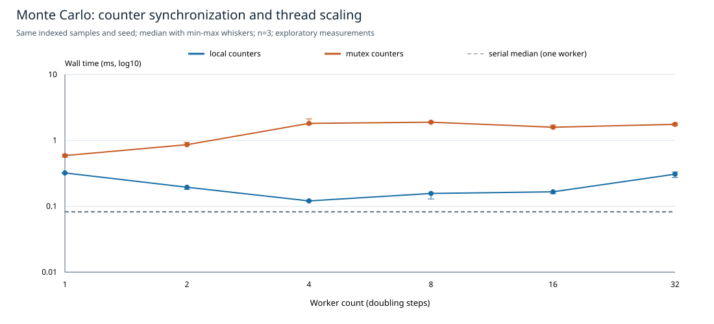
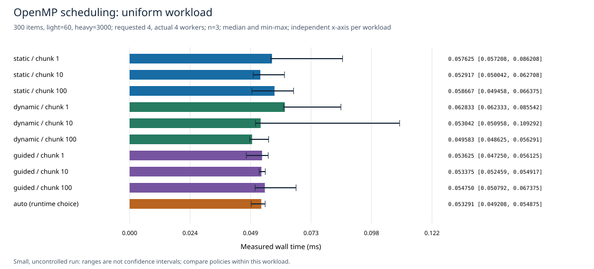
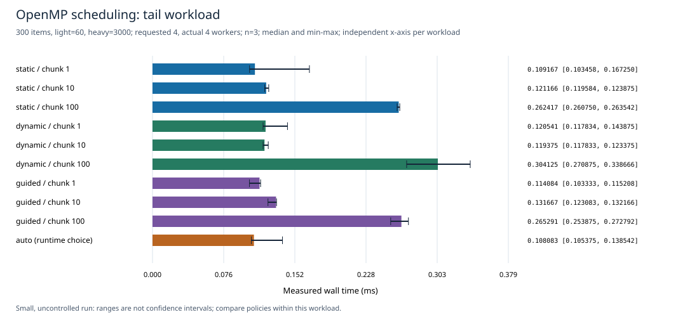

# CPU Benchmark Analysis

Derived from the retained exploratory measurements; **no new timings or GPU results** were created.

Source: [macos-arm64-smoke-2026-10-31-v3](../../results/macos-arm64-smoke-2026-10-31-v3/). 99 records, 33 configurations, 3 repeats per configuration.

The source run had no affinity, thermal/frequency or background-load control. Min-max whiskers show the observed repetitions, not confidence intervals. CPU model was not recorded in the source; it has not been inferred from a later host probe.

## Monte Carlo synchronization and scaling

The y-axis is logarithmic. The dashed serial median is a one-worker baseline, not another multithreaded series. Relative time below is median / serial median for identical samples; it is a run-specific ratio, not a general speedup claim.

| Mode | Workers | Median ms | Min-max ms | Relative time to serial |
|---|---:|---:|---:|---:|
| serial | 1 | 0.082500 | 0.082375-0.094584 | 1.000 |
| local | 1 | 0.320500 | 0.317208-0.321042 | 3.885 |
| local | 2 | 0.194542 | 0.179833-0.195042 | 2.358 |
| local | 4 | 0.120667 | 0.119625-0.122834 | 1.463 |
| local | 8 | 0.156541 | 0.129167-0.157125 | 1.897 |
| local | 16 | 0.165834 | 0.155042-0.166834 | 2.010 |
| local | 32 | 0.307209 | 0.273458-0.332542 | 3.724 |
| mutex | 1 | 0.588750 | 0.556375-0.609209 | 7.136 |
| mutex | 2 | 0.861042 | 0.850583-0.933500 | 10.437 |
| mutex | 4 | 1.812459 | 1.747833-2.117625 | 21.969 |
| mutex | 8 | 1.889125 | 1.852459-1.907958 | 22.898 |
| mutex | 16 | 1.585625 | 1.560958-1.711083 | 19.220 |
| mutex | 32 | 1.753916 | 1.676042-1.831292 | 21.260 |

## OpenMP: uniform

Panels have independent time-axis ranges. Compare policy/chunk settings within the same workload. Assigned-work imbalance is max worker iterations / mean worker iterations; 1.0 is equal assignment, not measured CPU utilization.

| Policy | Chunk | Actual workers | Median ms | Min-max ms | Assigned work max/mean |
|---|---:|---:|---:|---:|---:|
| static | 1 | 4 | 0.057625 | 0.057208-0.086208 | 1.000 |
| static | 10 | 4 | 0.052917 | 0.050042-0.062708 | 1.067 |
| static | 100 | 4 | 0.058667 | 0.049458-0.066375 | 1.333 |
| dynamic | 1 | 4 | 0.062833 | 0.062333-0.085542 | 1.040 |
| dynamic | 10 | 4 | 0.053042 | 0.050958-0.109292 | 1.067 |
| dynamic | 100 | 4 | 0.049583 | 0.048625-0.056291 | 1.333 |
| guided | 1 | 4 | 0.053625 | 0.047250-0.056125 | 1.067 |
| guided | 10 | 4 | 0.053375 | 0.052459-0.054917 | 1.120 |
| guided | 100 | 4 | 0.054750 | 0.050792-0.067375 | 1.333 |
| auto | runtime choice | 4 | 0.053291 | 0.049208-0.054875 | 1.080 |

## OpenMP: tail

Panels have independent time-axis ranges. Compare policy/chunk settings within the same workload. Assigned-work imbalance is max worker iterations / mean worker iterations; 1.0 is equal assignment, not measured CPU utilization.

| Policy | Chunk | Actual workers | Median ms | Min-max ms | Assigned work max/mean |
|---|---:|---:|---:|---:|---:|
| static | 1 | 4 | 0.109167 | 0.103458-0.167250 | 1.055 |
| static | 10 | 4 | 0.121166 | 0.119584-0.123875 | 1.288 |
| static | 100 | 4 | 0.262417 | 0.260750-0.263542 | 3.548 |
| dynamic | 1 | 4 | 0.120541 | 0.117834-0.143875 | 1.060 |
| dynamic | 10 | 4 | 0.119375 | 0.117833-0.123375 | 1.288 |
| dynamic | 100 | 4 | 0.304125 | 0.270875-0.338666 | 3.548 |
| guided | 1 | 4 | 0.114084 | 0.103333-0.115208 | 1.058 |
| guided | 10 | 4 | 0.131667 | 0.123083-0.132166 | 1.288 |
| guided | 100 | 4 | 0.265291 | 0.253875-0.272792 | 3.548 |
| auto | runtime choice | 4 | 0.108083 | 0.105375-0.138542 | 1.064 |

## Evidence and limits

[Statistics CSV](summary.csv) contains all configurations; [summary JSON](summary.json) preserves the legacy statistics schema. [Provenance](provenance.json) hashes the immutable source files and records validation scope.

Thread/team creation and synchronization are included in measured algorithm wall time; process startup and correctness references are excluded. These very small workloads expose startup/coordination effects. They do not establish a universally best thread count or scheduling policy. Compiler/flags in old metadata are operator declarations, not independently verified build commands. The analyzer checks internal consistency, not whether a timing record was genuinely executed.
