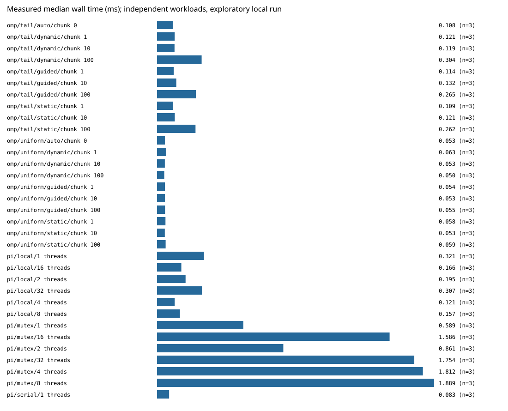

# Actual Local Smoke Measurements — 2026-10-31

This is the retained v3 smoke dataset for the current benchmark implementations, using worker-local OpenMP counters with one final statistics write per worker. Earlier exploratory datasets are preserved in the external pre-migration archive; they are not local ignored `local-superseded-*` directories. The four data files in this directory are retained as the raw-run record and its legacy combined summary/visualization. New derived analysis is written separately under `benchmarks/analysis/`.

This directory contains **real measurements**, executed on macOS 27.2 arm64 with 14 reported logical CPUs. No CPU affinity, thermal/frequency control, or background-load isolation was applied. Several configurations are sub-millisecond. These small workloads validate the benchmark pipeline and include startup/coordination costs; they are not production performance results.

- `raw.jsonl`: 99 measured records: 39 Monte Carlo and 60 OpenMP.
- `metadata.json`: UTC time, platform, compiler/flags supplied at execution, executable hashes, workload/repetition arguments, OpenMP environment.
- `summary.json`: median/min/max milliseconds per configuration.
- `medians.svg`: generated directly from those records; unrelated workloads share a display, not a throughput comparison.

Recorded build and run commands (repository root; destinations below already exist):

```sh
mkdir -p build
/opt/homebrew/opt/llvm/bin/clang++ -O3 -std=c++11 -Wall -Wextra -Wpedantic -pthread cpp-multithreading/src/main.cpp -o build/pi_mc
/opt/homebrew/opt/llvm/bin/clang++ -O3 -std=c++11 -Wall -Wextra -Wpedantic -fopenmp openmp-scheduling/src/main.cpp -o build/scheduling
python3 benchmarks/scripts/run_benchmarks.py --build build --out benchmarks/results/macos-arm64-smoke-2026-10-31-v3 --samples 100000 --repeats 3 --items 300 --light 60 --heavy 3000 --compiler 'Homebrew clang 23.1.4' --flags '-O3 -std=c++11; -pthread for pi_mc; -fopenmp for scheduling'
python3 benchmarks/scripts/analyze_results.py \
  benchmarks/results/macos-arm64-smoke-2026-10-31-v3 \
  --out benchmarks/analysis/macos-arm64-smoke-2026-10-31-v3
```

The historical raw and derived output directories already exist, so the run and analyze commands above document how this record was produced and will intentionally refuse to overwrite either destination. For new measurements, select a unique result directory; for reanalysis, choose a different new analysis directory. One discarded warmup process per configuration preceded three measured processes, whose order was shuffled with seed 2026.

| Configuration | Median ms | Min–max ms |
| --- | ---: | ---: |
| Monte Carlo serial, 1 worker | 0.082500 | 0.082375–0.094584 |
| Monte Carlo local, 4 workers | 0.120667 | 0.119625–0.122834 |
| Monte Carlo local, 32 workers | 0.307209 | 0.273458–0.332542 |
| Monte Carlo mutex, 4 workers | 1.812459 | 1.747833–2.117625 |
| OpenMP tail/dynamic/chunk 1 | 0.120541 | 0.117834–0.143875 |
| OpenMP tail/dynamic/chunk 100 | 0.304125 | 0.270875–0.338666 |

All Monte Carlo configurations produced the same count. Every OpenMP run validated each task against its serial reference. Full raw data covers 1/2/4/8/16/32 local and mutex workers, and static/dynamic/guided chunks 1/10/100 plus auto for both uniform/tail workloads at 4 requested workers.

The observed small-run ordering is not a stable scheduler ranking. No speedup claim or GPU result is derived from this run. The combined SVG predates the separated chart views and puts unlike workloads in one visualization; do not interpret its shared scale as a direct throughput comparison. Use the new [benchmark guide](../../README.md) for the data workflow and separated analysis, and see [methodology](../../../docs/methodology.md) for limitations.


