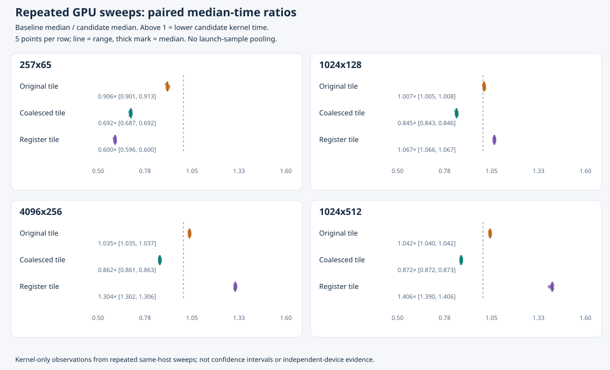

# Five repeated RTX 4060 sweeps: paired-ratio stability

This post-hoc analysis summarizes five consecutive fresh-process GPU sweeps recorded on 2026-10-31. Every sweep rebuilt and validated the same four kernels, then measured the same four shapes with 40 launches per kernel after ten warmups. The 3,200 launch samples remain grouped by sweep: they are not pooled into one timing distribution or treated as 3,200 independent experimental units.

## Analysis unit

For each sweep, shape and candidate, calculate:

```text
paired ratio = baseline median kernel time / candidate median kernel time
runtime reduction (%) = 100 × (1 − candidate median / baseline median)
```

Report the median and min–max range of the **five paired ratios**. This differs from dividing pooled medians or selecting the best launch. A ratio above 1 means a lower candidate median time in that sweep; the baseline's ratio is always 1.

| Shape (samples × features) | Baseline | Original tiled: median [range] | Coalesced tiled: median [range] | Register tiled: median [range] |
| --- | ---: | ---: | ---: | ---: |
| 257 × 65 | 1.000× | 0.906× [0.901–0.913] | 0.692× [0.688–0.692] | 0.600× [0.596–0.600] |
| 1024 × 128 | 1.000× | 1.007× [1.005–1.008] | 0.845× [0.843–0.846] | 1.067× [1.066–1.067] |
| 4096 × 256 | 1.000× | 1.035× [1.035–1.037] | 0.862× [0.861–0.863] | 1.304× [1.302–1.306] |
| 1024 × 512 | 1.000× | 1.042× [1.040–1.042] | 0.872× [0.872–0.873] | 1.406× [1.390–1.406] |



`register_tiled` had a lower median time in all five sweeps for each of the three larger shapes, and lost in all five sweeps for 257×65. Its five-sweep median ratio at 1024×512 is `1.405545814871763`, range `1.3899306059267231–1.4056338650487878`; the median paired runtime reduction is about **28.85%**, not a 40.6% time reduction. At 4096×256 the median ratio is `1.3035479725074952`, range `1.302075855038692–1.3055719131469123`, with median paired time reduction about 23.29%.

The negative ablation also repeats: `coalesced_tiled` lost to baseline on all four shapes in all five sweeps. Original tiling likewise lost on the smallest shape. No candidate is universally faster; the table retains every implementation and shape rather than only the largest gain.

## Validation and provenance

All five records have `status: complete`, the same source/device/compiler/driver/architecture/configuration/measurement policy, and zero return codes for all 14 commands per sweep. Each passed the CPU reference, 50 host layout/oracle cases, 12 GPU shapes for all four kernels, and Compute Sanitizer memcheck/racecheck with zero reported errors or warnings. Before/after-timing CPU comparisons also passed. The input/tolerance contract is the bounded FP32 computation `XᵀX/m`, with `abs_error <= 2e-4 + 2e-4*abs(reference)`; this is not mean-centered covariance.

Environment: RTX 4060 (compute capability 8.9, inventory 8,188 MiB), WSL2 Linux 6.6.87.2, CUDA 13.3 / `nvcc` 13.3.73, Windows driver 610.88, `-std=c++17 -O3 -lineinfo -arch=sm_89`. The 20 recorded source hashes match source snapshot `1f3a10dd738ab0c5d6bfdb8ee8ee5a0b811a289b`; the measured source files are unchanged from run 03. Rebuilt executables may have distinct binary hashes; the analyzer retains each recorded identity rather than requiring cross-sweep binary-byte equality. Binaries are not committed and cannot be independently rehashed from this evidence.

The analyzer checks each execution gate, result SHA-256 values, per-shape raw/combined agreement, summary statistics, full variant configuration, repetition policy, validation logs and normalized build arguments before aggregating. Build output paths are allowed to vary between fresh sweeps; compiler options and source argument structure must agree. Its new host-only tests use explicitly synthetic fixtures, including a case that distinguishes paired-ratio aggregation from pooled medians. They are not GPU measurements.

Derived files:

- [summary.json](summary.json): all five paired ratios and their median/range, per-shape/per-kernel improvement counts and common recorded conditions.
- [per-run.csv](per-run.csv): all 80 sweep × shape × kernel comparisons, with median times, paired ratio, sample count and paired runtime reduction.
- [provenance.json](provenance.json): SHA-256 of all 180 input files, analyzer identity, sweep timestamps and each sweep's recorded binary hashes. Labels are relative directory names.
- [stability.svg](stability.svg): all five points for each of the three candidates at each shape, with median/range and a baseline ratio of 1. Baseline rows remain in the JSON/CSV.

Original directories are unchanged: [sweep 1](../rtx4060-repeat-20261031T095734Z-1/), [sweep 2](../rtx4060-repeat-20261031T095734Z-2/), [sweep 3](../rtx4060-repeat-20261031T095734Z-3/), [sweep 4](../rtx4060-repeat-20261031T095734Z-4/), [sweep 5](../rtx4060-repeat-20261031T095734Z-5/). Historical [run 02](../rtx4060-wsl-run-02/README.md) and [run 03](../rtx4060-wsl-run-03/README.md) remain separate; their medians are not used as denominators here.

## Reproduce the post-hoc analysis

From `cuda-kernel-optimization/`, choose a new output directory:

```sh
python3 benchmarks/analyze_repeated_runs.py \
  results/rtx4060-repeat-20261031T095734Z-{1,2,3,4,5} \
  --out results/rechecked-repeat-analysis
```

The analyzer refuses existing output or output nested inside an input sweep, copied execution records, incompatible conditions, invalid samples and inconsistent evidence. It does not execute CUDA, alter measurements or establish result authenticity. A separate audit independently recomputed all ratios and checked the generated summaries and CSV against the recorded raw samples. SVG XML/geometry was checked; rendered visual QA was not available on the review host.

## Limits

These are five consecutive fresh-process runs on one GPU/host/day, not independently controlled machines, thermal states or workload conditions. Clocks, power policy, temperature and background load were not fixed. The narrow observed ranges describe repeatability in that sequence; they are not confidence intervals or proof of statistical significance or general superiority. Forty launches per kernel are nested within each sweep, not forty independent sessions. No transfer/CPU-reference time is included, and no end-to-end or CPU/GPU speedup is measured. No profiler counters or compiler register report establish why a kernel wins, loses or uses particular hardware resources.
