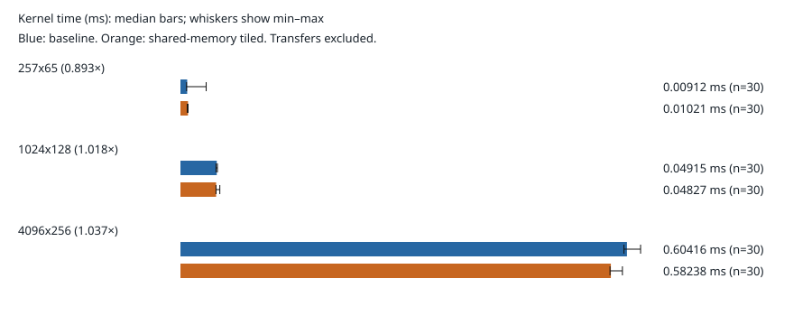

# RTX 4060 WSL2 validation and kernel timings

Recorded on 2026-10-31. Both kernels compute the uncentered second-moment matrix `XᵀX/m`, with `samples × features` row-major input; this is not mean-centered covariance. This directory retains one successful target-device run, not a benchmark executed on the macOS review host.

## Environment and procedure

- GPU: NVIDIA GeForce RTX 4060, compute capability 8.9; device inventory reports 8,188 MiB.
- Host: WSL2 Linux 6.6.87.2, x86_64, glibc 2.39.
- CUDA Toolkit: 13.3, `nvcc` 13.3.73; Windows driver inventory: 610.88. CUDA runtime/driver API version fields both report `13030` (these API version fields are distinct from the Windows driver package number).
- Build: direct `nvcc`, `-std=c++17 -O3 -lineinfo -arch=sm_89`; 16×16 thread blocks. This run did not use CMake/CTest.
- Three warmup launches per kernel, followed by 30 measured launches per kernel per shape. Kernel order alternates between repetitions; timing uses CUDA events with stop-event synchronization.
- CPU FP64 reference calculations, allocation and transfers occur outside timed regions. Every output is checked before and after timing using `abs_error <= 2e-4 + 2e-4*abs(reference)` for the deterministic bounded inputs.

## Recorded validation

All 12 recorded build/test/measurement/analysis commands returned zero. The host reference passed, and the GPU correctness executable passed both kernels for `(1,1), (1,17), (17,1), (7,9), (16,16), (17,19), (33,31), (257,65)`. Compute Sanitizer checked that same eight-shape executable:

- [memcheck log](logs/memcheck.stdout.log): `ERROR SUMMARY: 0 errors`.
- [racecheck log](logs/racecheck.stdout.log): `0 hazards displayed (0 errors, 0 warnings)`.
- Each of the three timed workloads also passed before/after-timing CPU comparisons. Sanitizer coverage of the correctness executable is not a separate sanitizer run for every timed workload.

The separate record audit checked all three result SHA-256 values, all 180 positive finite timing samples, per-shape raw/combined agreement, and independently recomputed medians, min–max ranges and ratios. Analyzer replay reproduced the summary values and SVG bytes exactly. All 15 recorded source hashes equal the exact LF→CRLF conversion of the repository source files: the target Windows checkout used CRLF, while Git stores LF. The original hashes were preserved rather than normalized in place.

The target binaries are intentionally excluded from Git. Their recorded hashes are available, but the reviewer could not independently rehash or rerun those absent binaries on macOS. The review also passed 14 host Python tests; this is separate from the GPU execution evidence.

## Measured results

Times are milliseconds. Each kernel/shape has 30 samples; ratios are baseline median divided by tiled median.

| Input shape | Baseline median | Baseline min–max | Tiled median | Tiled min–max | Baseline / tiled |
| --- | ---: | ---: | ---: | ---: | ---: |
| 257 × 65 | 0.009120 | 0.008192–0.034816 | 0.010208 | 0.009216–0.010240 | 0.893× |
| 1024 × 128 | 0.049152 | 0.048128–0.050016 | 0.048272 | 0.048128–0.053280 | 1.018× |
| 4096 × 256 | 0.604160 | 0.600064–0.622592 | 0.582384 | 0.581248–0.598016 | 1.037× |

The tiled kernel took about 11.93% longer on the smallest case and about 1.79%/3.60% less elapsed kernel time on the larger cases. The smallest baseline case includes a retained 0.034816 ms maximum; no samples were discarded. These are descriptive comparisons of one session, not confidence intervals or evidence of a universal tiling benefit.

## Evidence and limitations

- [execution.json](execution.json): status, device/toolchain inventory, exact commands, source/binary/result hashes and validation gates.
- [benchmark.json](benchmark.json): combined raw samples and measured GPU/runtime metadata.
- [summary.json](summary.json): unrounded medians, counts, ranges and ratios.
- [raw/](raw/): per-shape source records; [logs/](logs/) retain command output.

GPU clocks, thermal state, power policy and background load were not fixed. The three warmups and alternating order address basic measurement consistency but do not remove those effects. There is only one independent session; 30 repeated launches are not 30 independent device sessions. The results measure kernel execution only and do not include transfer cost, compare against CPU timing, or establish end-to-end application throughput. No profiler counters were captured to attribute differences to bandwidth, occupancy or cache behavior. FP32 accuracy and performance outside these inputs and dimensions remain unverified.

For a new independent sweep, use [the execution guide](../../docs/gpu-execution.md) and a new output directory. Keep this recorded run unchanged.
