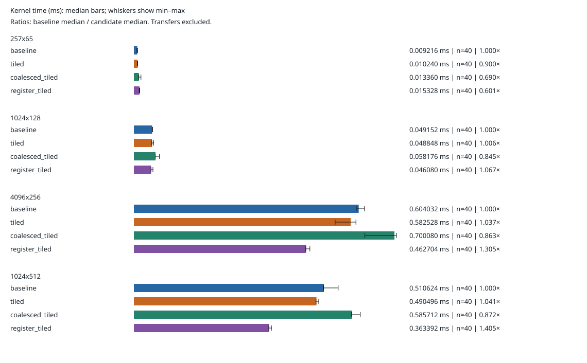

# RTX 4060 four-kernel validation and timing ablation

Recorded on 2026-10-31 using source snapshot `33c55361a4eb13300cb04fc08afb33206f405aa8`. All four implementations compute the same uncentered second-moment matrix `XᵀX/m`; the input shape is `samples × features`. This record includes a successful target-GPU session and a separate consistency review on macOS, not a GPU rerun by that reviewer.

## Environment and measurement policy

- NVIDIA GeForce RTX 4060, compute capability 8.9; inventory reports 8,188 MiB.
- WSL2 Linux 6.6.87.2, x86_64, glibc 2.39; Windows driver package 610.88.
- CUDA Toolkit 13.3, `nvcc` 13.3.73; CUDA runtime/driver API fields both `13030`, distinct from the Windows driver package number.
- Direct compiler build: `-std=c++17 -O3 -lineinfo -arch=sm_89`, no fast-math flag. The run did not use CMake.
- Ten warmups per implementation, 40 measured launches per kernel and shape. Order rotates so each kernel occupies each execution position ten times.
- Allocation, CPU FP64 reference work and host/device transfers occur outside CUDA-event timing. Stop-event synchronization checks completion before reading each elapsed time. Output checks run before and after timing.

| Implementation | Thread block | Output tile | Reduction tile | Outputs per thread |
| --- | ---: | ---: | ---: | ---: |
| `baseline` | 16×16 | 16×16 | 1 | 1 |
| `tiled` | 16×16 | 16×16 | 16 | 1 |
| `coalesced_tiled` | 16×16 | 16×16 | 16 | 1 |
| `register_tiled` | 32×8 | 32×32 | 32 | 4 |

The register-tiled source keeps four per-thread accumulators and reuses right-hand values across them. This expresses an implementation strategy; no compiler register report or profiler counter establishes actual register placement or pressure.

## Validation and record audit

All 14 recorded build/test/measurement/analysis commands returned zero. The host reference passed, and the [host layout log](logs/host-layout.stdout.log) reports 50 layout/oracle cases. Every kernel passed GPU correctness for `(1,1), (1,17), (17,1), (7,9), (16,16), (17,19), (33,31), (257,65), (32,32), (33,33), (63,65), (65,63)` against the FP64 CPU reference.

- [GPU correctness](logs/gpu-correctness.stdout.log): 12 shapes passed for all four implementations.
- [memcheck](logs/memcheck.stdout.log): zero errors.
- [racecheck](logs/racecheck.stdout.log): zero hazards displayed, zero errors and zero warnings.

Sanitizer coverage is for that 12-shape correctness executable, not a separate sanitizer sweep of each timed workload. All timed shapes also passed before/after-timing CPU comparisons with `abs_error <= 2e-4 + 2e-4*abs(reference)`. Every kernel's recorded maximum absolute error is `1.4495293e-08` for 257×65 and zero for the other three supplied inputs. Those observations do not establish exact arithmetic or a universal error bound.

The separate audit checked all 20 source hashes against the exact LF bytes at source commit `33c5536`, all three result hashes, raw/combined agreement, all 640 positive finite samples, variant configurations, the warmup/order policy, and independently recomputed medians, min–max ranges and ratios. Analyzer replay reproduced the summary values and SVG bytes exactly; 34 host Python tests passed. Unlike historical run 02, this run's source-hash match needs no CRLF conversion.

Target binary hashes remain in the execution record, but executables are intentionally not in Git. They could not be independently rehashed or rerun from the recorded artifacts on macOS. The separately verified CPU-only CMake/CTest run does not establish CUDA-enabled CMake or GPU CTest coverage.

## Measured outcomes

Medians below are milliseconds from 40 launches per kernel/shape. No samples were discarded. Min–max ranges and unrounded medians are retained in [summary.json](summary.json) and visualized below.

| Input shape | Baseline | Original tiled | Coalesced tiled | Register tiled |
| --- | ---: | ---: | ---: | ---: |
| 257 × 65 | 0.009216 | 0.010240 | 0.013360 | 0.015328 |
| 1024 × 128 | 0.049152 | 0.048848 | 0.058176 | 0.046080 |
| 4096 × 256 | 0.604032 | 0.582528 | 0.700080 | 0.462704 |
| 1024 × 512 | 0.510624 | 0.490496 | 0.585712 | 0.363392 |

Ratios use **the baseline median from this same session divided by the candidate median**. A value below 1 means that candidate was slower.

| Input shape | Baseline / tiled | Baseline / coalesced | Baseline / register |
| --- | ---: | ---: | ---: |
| 257 × 65 | 0.900× | 0.690× | 0.601× |
| 1024 × 128 | 1.006× | 0.845× | 1.067× |
| 4096 × 256 | 1.037× | 0.863× | 1.305× |
| 1024 × 512 | 1.041× | 0.872× | 1.405× |

The negative ablation matters: `coalesced_tiled` was slower than the direct baseline on every measured shape, despite contiguous cooperative loads in the source. The sweep does not establish whether shared-memory access, instruction overhead, barriers, caching or another factor explains that result.

`register_tiled` used about 6.25%, 23.40% and 28.83% less median kernel time on the three larger cases, but about 66.32% more on 257×65. The best observed 1.405× ratio corresponds to 28.83% less time, not 40.5% less time. This implementation changes tile size, block shape and per-thread work together; no single-variable or profiler evidence attributes the difference to one feature.

## Evidence and limits

- [execution.json](execution.json): environment, command return codes, source/binary/result hashes and validation gates.
- [benchmark.json](benchmark.json): all 640 raw event samples and per-variant metadata.
- [summary.json](summary.json): exact medians, min–max spread, counts and baseline-relative ratios.
- [raw/](raw/): four per-shape records; [logs/](logs/) retain every command's output.
- [Historical run 02](../rtx4060-wsl-run-02/README.md): separate two-kernel source snapshot and policy. Its medians are not used in these ratios.

GPU clocks, thermal state, power policy and background load were not fixed. Forty launches in one session are not forty independent sessions or confidence intervals across devices. Kernel-only CUDA-event timing excludes transfers and CPU reference work; no CPU/GPU or end-to-end application speedup is measured. There are no profiler counters for bandwidth, cache behavior, barriers, occupancy or register allocation. Independent repeated sweeps and profiling are needed before causal or general performance claims. The FP32 input/tolerance contract remains bounded to the tested workloads.

Use [the execution guide](../../docs/gpu-execution.md) with a new output directory for follow-up work. Preserve this recorded run unchanged.
